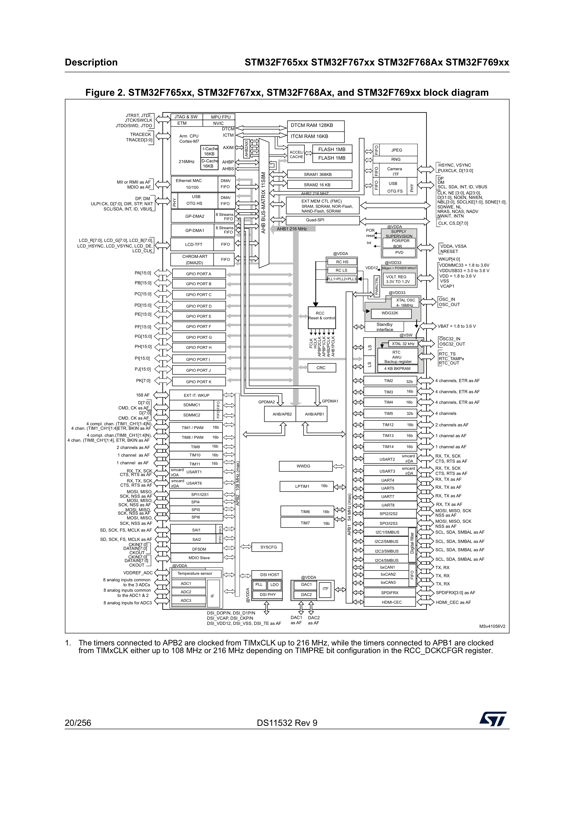

# STM32F767ZIT6 — Embedded Systems & Bare-Metal Architecture

-2E7D32?style=flat-square)

Repository tecnica dedicata allo studio sistematico, all'analisi architetturale a livello di registro (**Bare-Metal / CMSIS**) e all'implementazione **HAL** delle periferiche del microcontrollore **STM32F767ZIT6** (su scheda *NUCLEO-F767ZI*).

Ogni modulo segue un approccio rigoroso da **Ingegneria Elettronica e Informatica**:
1. **Analisi Teorica & Hardware**: studio del *Reference Manual (RM0410)*, diagrammi a blocchi, clock domain, bus matrix e timing.
2. **Implementazione Bare-Metal (CMSIS)**: manipolazione diretta dei registri (`stm32f767xx.h`), maschere bit-a-bit, gestione atomica (`BSRR`) e assenza di astrazioni nascoste.
3. **Implementazione Production (HAL + DMA)**: pattern industriali, gestione eventi asincroni, *Cache Coherency* e ottimizzazione deterministica.

---

## Specifiche Chiave del Target (STM32F767ZIT6)

| Parametro | Specifica Tecnica | Note Architetturali |
| :--- | :--- | :--- |
| **Core** | ARM Cortex-M7 r1p1 @ **216 MHz** | Pipeline superscalare a 6 stadi, Branch Prediction (462 DMIPS) |
| **FPU** | IEEE-754 Single & Double Precision | `FPv5-D16` (32 registri SP / 16 registri DP) |
| **Cache L1** | 16 KB I-Cache + 16 KB D-Cache | Richiede gestione esplicita (`SCB_Clean/InvalidateDCache`) con DMA |
| **Flash Memory** | 2 MB Dual-Bank | Accesso via bus AXI (`0x08000000`) o ITCM (`0x00200000` + ART Accelerator) |
| **SRAM Totale** | **512 KB** partizionati | 128 KB DTCM + 368 KB SRAM1 + 16 KB SRAM2 (+ 16 KB ITCM-RAM) |
| **Package** | LQFP144 | 114 I/O tolleranti a 5V (FT) |

---

## Block Diagram & Bus Matrix Architecture

  

*Architettura interna STM32F767xx: AHB Bus-Matrix 11S8M, memorie ITCM/DTCM/SRAM e domini di clock APB1/APB2 (Fonte: STMicroelectronics DS11532 Rev 9, Fig. 2).*

---

## Syllabus & Roadmap di Studio

Ogni cartella in `modules/` contiene documentazione tecnica (`README.md`), calcoli dei registri e codice sorgente compilabile.

- [x] **00. Architettura Cortex-M7, Memory Map & Linker Script** (`docs/`)
- [x] **01. RCC & Clock Tree** — PLL, HSE Bypass 8 MHz, Over-Drive Mode a 216 MHz, Flash 7 WS (`modules/01_rcc_clock_tree/`)
- [x] **02. GPIO & EXTI** — Registri `MODER/OTYPER/OSPEEDR/PUPDR/BSRR`, Alternate Functions, Interrupt esterni (`modules/02_gpio_exti/`)
- [ ] **03. NVIC & SysTick** — Priority Grouping (`AIRCR`), Preemption vs Subpriority, Timebase deterministico (`modules/03_nvic_systick/`)
- [ ] **04. Architettura DMA** — DMA1/DMA2, Stream/Channel mapping, FIFO, Double-Buffer, Coerenza D-Cache (`modules/04_dma_architecture/`)
- [ ] **05. Timer & PWM** — Basic, General-Purpose, Advanced Control (`TIM1/TIM8`), Dead-Time, Input Capture (`modules/05_timers_pwm/`)
- [ ] **06. USART / UART** — Oversampling, Baudrate fraction, DMA + Idle Line Detection + Ring Buffer (`modules/06_usart_uart/`)
- [ ] **07. SPI & I2C** — Clock polarity/phase, Full-Duplex DMA, I2C Timing Register (`TIMINGR`), Clock Stretching (`modules/07_spi_i2c/`)
- [ ] **08. ADC & DAC** — 12-bit SAR ADC, Multi-channel Scan, Trigger hardware da Timer, DMA circular (`modules/08_adc_dac/`)
- [ ] **09. FPU, L1 Cache & MPU** — Configurazione Memory Protection Unit per regioni DMA non-cacheable (`modules/09_fpu_cache_mpu/`)
- [ ] **10. FMC (Flexible Memory Controller)** — Interfacciamento SDRAM esterna e display paralleli (`modules/10_fmc_external_mem/`)
- [ ] **11. Ethernet MAC + LwIP** — RMII con PHY LAN8742A, DMA Descriptors in SRAM2 (`modules/11_ethernet_lwip/`)
- [ ] **12. USB OTG FS** — Descrittori USB, Enumeration, CDC Virtual COM Port (`modules/12_usb_otg_fs/`)

---

## Hardware Reference Rapido (NUCLEO-F767ZI)

| Funzione | Pin MCU | Configurazione / Note |
| :--- | :--- | :--- |
| **LD1 (Verde)** | `PB0` | Output Push-Pull (Active High) |
| **LD2 (Blu)** | `PB7` | Output Push-Pull (Active High) |
| **LD3 (Rosso)** | `PB14` | Output Push-Pull (Active High) |
| **User Button B1** | `PC13` | Input + `EXTI13` (Active High, pull-down esterno su board) |
| **ST-LINK VCP TX** | `PD8` | `USART3_TX` (`AF7`) |
| **ST-LINK VCP RX** | `PD9` | `USART3_RX` (`AF7`) |
| **HSE Clock In** | `PH0` | 8 MHz MCO da ST-LINK (`HSEBYP = 1`) |

---

## Toolchain & Build System

Il progetto utilizza **CMake** con toolchain `arm-none-eabi-gcc` per garantire build riproducibili e indipendenti dall'IDE (compatibile con VS Code + Cortex-Debug, CLion o terminale puro).

### Compilazione

    cmake -B build -G Ninja -DCMAKE_TOOLCHAIN_FILE=cmake/arm-none-eabi-gcc.cmake
    cmake --build build

---

## Documentazione Ufficiale di Riferimento (STMicroelectronics)
* **RM0410**: *STM32F76xxx and STM32F77xxx advanced Arm®-based 32-bit MCUs Reference Manual*
* **DS11532**: *STM32F765xx, STM32F767xx, STM32F768Ax, STM32F769xx Datasheet*
* **PM0253**: *STM32F7 Series Cortex®-M7 processor programming manual*
* **ES0334**: *STM32F76xxx and STM32F77xxx device errata*
* **UM1974**: *STM32 Nucleo-144 boards User Manual*
